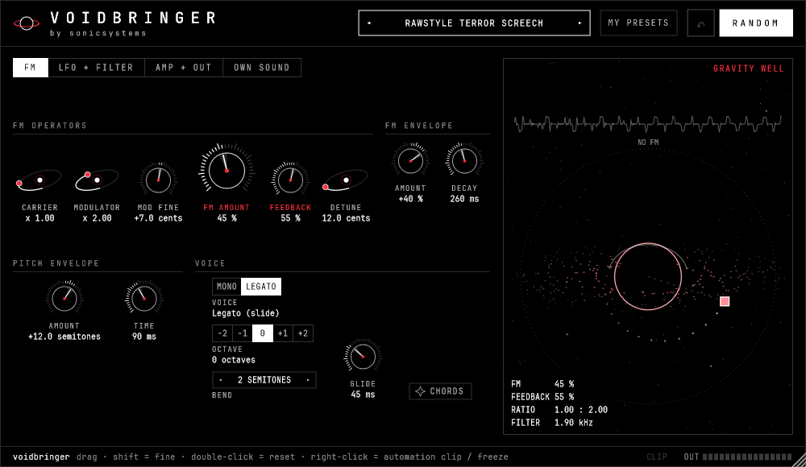

# voidbringer

FM screech synth for hardstyle / rawstyle by **sonicsystems** (VST3 + CLAP, Windows).



- 2-operator FM with feedback, 4x oversampled, mono / legato slides or 6-voice chords
- LFO (tempo sync), lowpass / bandpass / vowel filter, distortion + multiband "OTT", soft clip
- 16 factory presets, MY PRESETS, RANDOM with undo and FREEZE (right-click a control)
- OWN SOUND: layer or replace with your own sample
- The gravity well: drag the probe around the black hole to set FM amount and feedback. The hole glows white on clean
  sounds and turns red as the sound gets harder.

## Build (Windows)

Needs Visual Studio 2022/2026 with C++ and CMake tools, plus JUCE 8.0.4 in `deps/JUCE` and clap-juce-extensions in
`deps/cje`.

```
python build.py            # builds, runs the render test, puts the plugin in out\
python build.py --install  # also installs into C:\Program Files\Common Files\VST3 (run as administrator)
```

Fonts: JetBrains Mono (SIL Open Font License, see `fonts/JetBrainsMono-OFL.txt`).
